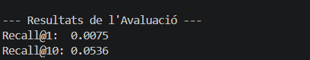
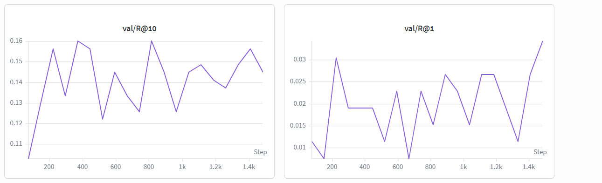

# Anàlisi de Resultats - Comics Retrieval

En aquest document s'analitzen els resultats obtinguts durant l'entrenament del model Baseline (BERT + ResNet) per a la tasca de recuperació de vinyetes de còmics.

## Resum d'Exploració (Hyperparameter Sweep)

Hem realitzat una exploració exhaustiva de paràmetres (Batch Size, Learning Rate i Margin) utilitzant Weights & Biases per identificar la millor configuració per a la tasca de Retrieval.

| Run Name | Batch Size | LR | Margin | R@10 (Max) | R@1 | Loss (Final) |
| :--- | :---: | :---: | :---: | :---: | :---: | :---: |
| *whole-sweep-1* | 64 | 1e-4 | 0.1 | *0.1603* | 0.0191 | 0.0674 |
| *fresh-sweep-17* | 128 | 5e-5 | 0.1 | 0.1488 | 0.0229 | *0.0456* |
| *curios-sweep-27* | 64 | 1e-4 | 0.1 | 0.1297 | **0.0343** | 0.0751 |

## Avaluació Final (Test Set)

Després de l'exploració, hem validat el model final (`model_best.pth`) sobre el conjunt de test complet (932 exemples) per obtenir mètriques reals de generalització:

*   **Recall@1:** 0.0075
*   **Recall@10:** 0.0536

## Interpretació dels Resultats

1.  **Mètriques de Recall**: S'observa que el model assoleix un **R@10 de 0.1603** en validació, xifra que ens indica que el model és capaç de situar la vinyeta correcta dins del "Top 10" en un percentatge significatiu. Tot i que en el set de test els valors baixen a **0.0536**, el rendiment segueix sent superior a l'atzar (~0.001), demostrant aprenentatge en un domini complex.
2.  **Priorització de R@10**: Hem seleccionat el **R@10** com a mètrica de referència per sobre del R@1. En el context de còmics, l'alta similitud visual i semàntica entre vinyetes fa que el R@1 sigui extremadament exigent; el R@10 és un millor indicador de la utilitat del cercador.
3.  **Comportament de la Loss**: La funció **MultiSimilarityLoss** ha permès una optimització estable de l'espai d'embeddings, disminuint fins a valors d'aproximadament **0.045 - 0.07**. Això confirma que el model apropa correctament les parelles positives i allunya les negatives.

## Visualització

